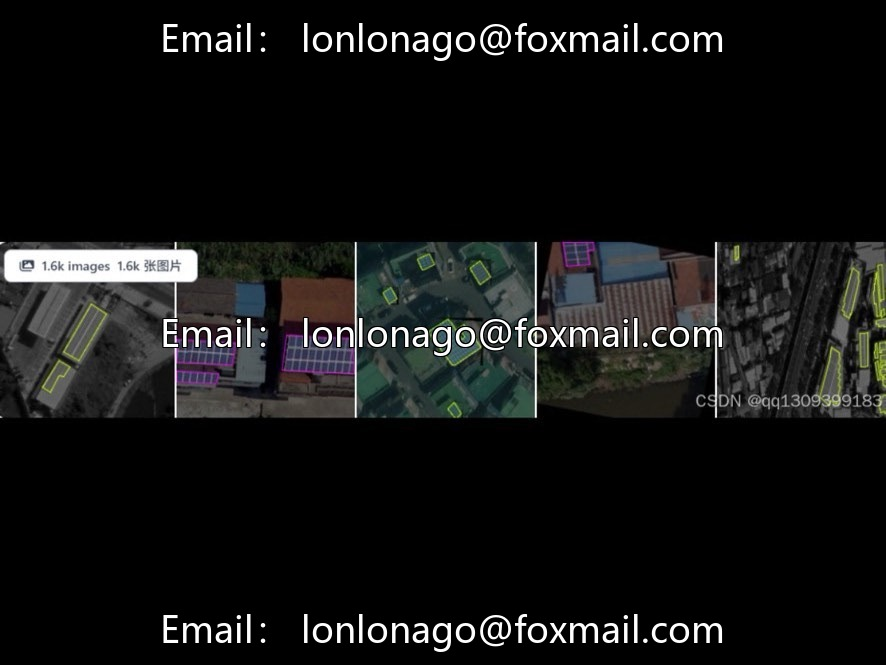
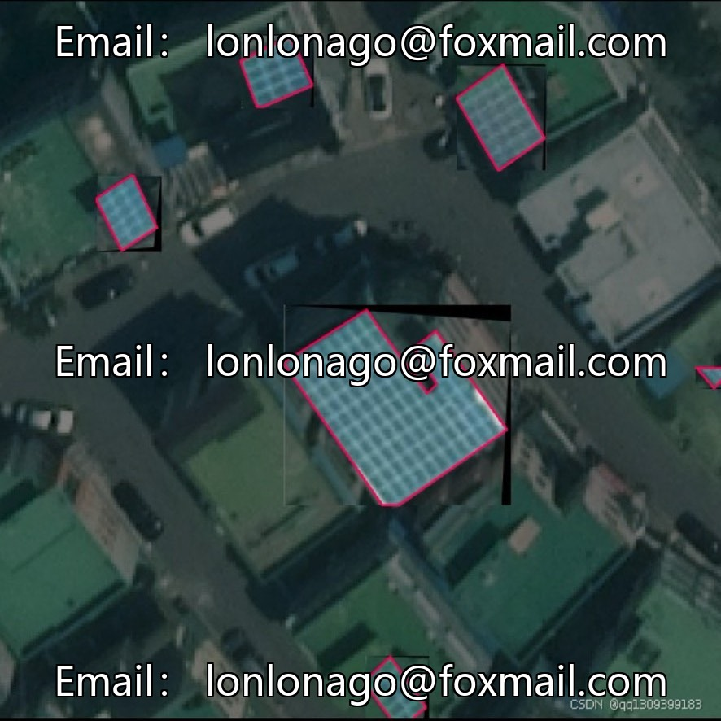
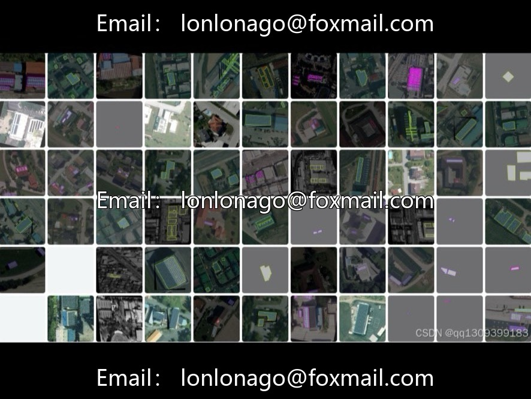
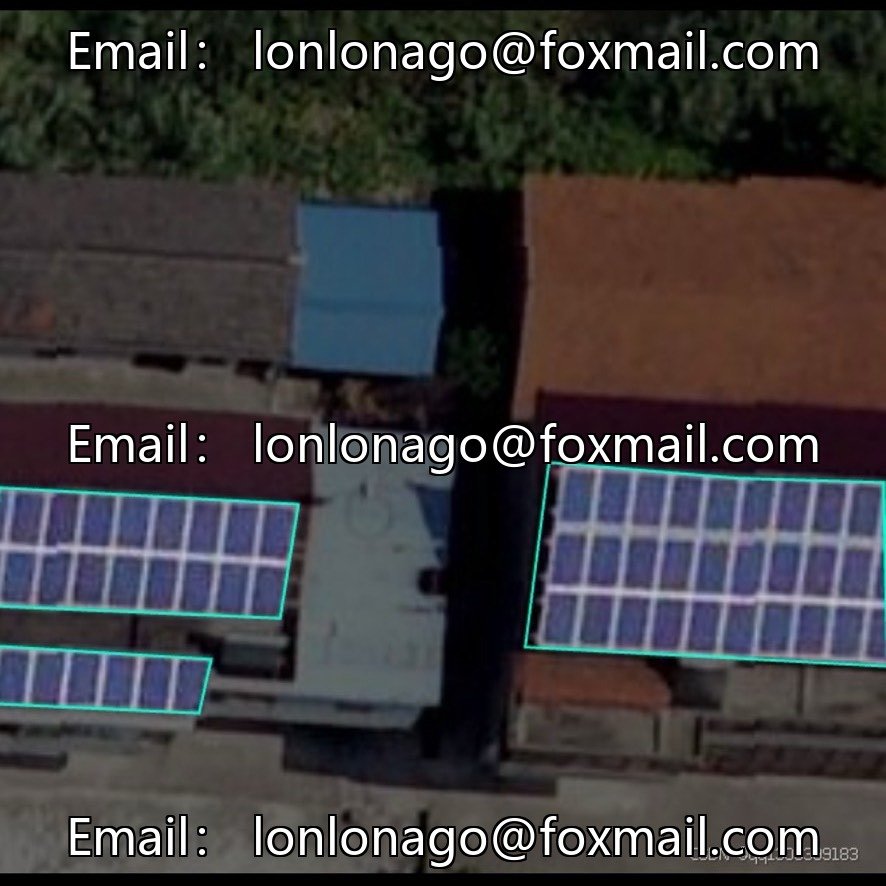
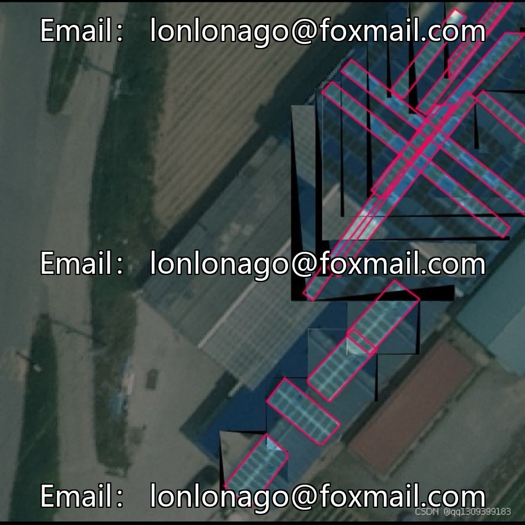
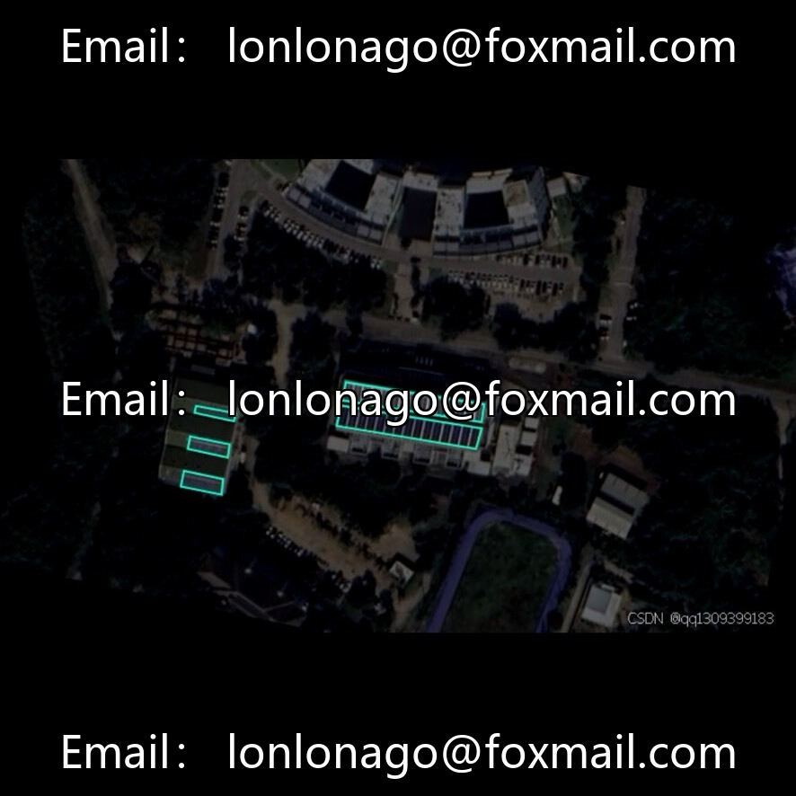

# Drone-photovoltaic panel aerial photography segmentation dataset, issue 10069

## Body

Drone-photovoltaic panel aerial photography segmentation dataset, issue 10069

The dataset consists of 1,586 high-precision annotated images, with each photovoltaic panel separately outlined and the edges' shadows and seams marked clearly. It comes with a pre-trained instance segmentation model that can be directly used for inference or fine-tuning, reducing the barriers to algorithm development.

Cover 8 categories related to photovoltaics (including multilingual annotations), it is recommended to merge or map categories based on requirements. Dataset specifications: instance segmentation task, 1,586 images, 8 classes, pixel-level contour annotations, with pre-trained models.

Suitable for scenarios such as photovoltaic operation and maintenance, power grid planning, environmental monitoring, and algorithm research. The dataset includes rooftop and desert photovoltaic power station scenarios, suitable as specialized data for baseline tasks in the photovoltaic field.

Virtual materials, once sold, are non-refundable.
Interested friends, click "I want" to proceed.

## Images

## Payment

Here is a pay link on Stripe ( https://buy.stripe.com/3cs8yP7sY87d0vu9AB ). Please contact me lonlonago@foxmail.com after funding $89, and I will send you a complete data files , thank you!

